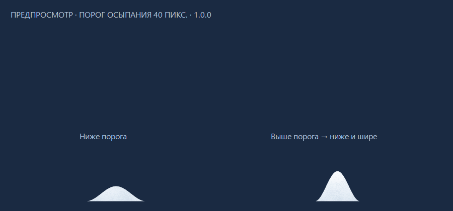

# Снег · маленькая зима

Настольное приложение для Windows 11 x64: снег падает поверх окон, накапливается на их верхних границах и внизу экрана. Текущая версия — **1.0.0**.

## Возможности

- Настройки интенсивности, размера, скорости и ветра; режимы лёгкого снега, обычного снегопада и метели.
- Снежные свесы по углам окон, осыпание при движении окна и заполнении сугроба.
- Снежки: скатывание, броски, разрушение при сильном ударе и сборка снеговика.
- «Горсть»: зачерпнуть и бросить снег россыпью в направлении мыши.
- Варежка и лопата для уборки.
- Гусеничный снегоуборщик: случайный въезд слева или справа, вал и выброс снега, замедление в глубоком слое.
- Формочка для снежных кирпичиков: перетаскивание, поворот колесом и фиксация клавишей F.
- Стряхивание снега мышью, мягкие кучи и настраиваемая высота начала осыпания.
- Возможность заполнить нижним снегом весь экран доверху.
- Отдельная громкость звуков снегопада и инструментов, общий выключатель.

## Запуск

Скачайте архив приложения в разделе [Releases](https://github.com/MarkTop200/sneg-desktop/releases/latest), распакуйте целиком в доступную для записи папку и запустите `Sneg.exe`. Требуется .NET Framework 4.8 или совместимый 4.x. Установка и права администратора не нужны. Сборка не подписана сертификатом издателя.

Панель открывается двойным щелчком по снежинке в области уведомлений. Крестик скрывает панель; «Выход» полностью завершает приложение. «Снегопад» содержит основные параметры и флажок заполнения экрана доверху. При его выключении нижний слой возвращается к обычному пределу высоты.

## Управление

Выберите инструмент в панели или меню значка. «Снежок» скатывает снег при перетаскивании. «Горсть» забирает рыхлый снег: сделайте взмах и отпустите кнопку мыши. Варежка и лопата убирают снег. Три шара друг на друге образуют снеговика.

- `Escape` — отключить инструмент и освободить мышь.
- `Ctrl+Alt+S` — переключить инструмент «Снежок»; букву можно изменить в настройках.
- `Ctrl+Alt+Shift+Q` — аварийно отключить эффект.

Если сочетание занято, используйте панель или меню значка. Кирпичики можно брать и без выбранного инструмента. Пока держите кирпичик, колесо поворачивает его, F (физическая клавиша А в русской раскладке) фиксирует или освобождает. В остальных местах без инструмента клики проходят к другим приложениям. «Звуки зимы» содержит общий выключатель и отдельные уровни; 0% отключает выбранный звук. Звук горсти использует канал снежка.

Снег с окон остаётся внизу, включая пространство под окнами. Прямые снежинки не пополняют нижний слой в тени окон. При сужении окна осыпаются обрезанные края, а снег на сохранившейся части остаётся. Высокие кучи постепенно расширяются у основания; порог настраивается в панели. Снежная сцена после выхода не сохраняется.

## Приватность

Приложение не обращается к сети, не читает текст и заголовки чужих окон и не сохраняет экран. Для опоры снега определяется геометрия окон. Параметры и диагностические журналы сохраняются в `Data` рядом с программой. Автозапуск включается только соответствующим флажком.

## Сборка и проверки

Исходники — в `Source`. Скрипт `build.ps1` использует системный компилятор .NET Framework и не загружает зависимости:

```powershell
.\build.ps1
Start-Process .\Sneg.exe -ArgumentList '--self-test' -Wait
```

Результаты автоматических проверок — в `Tests/automated-results.md`. Последний прогон: **114/114**. Проверены физика, сохранение параметров, отключение синтезированного звука, оба направления снегоуборщика и регрессия слабого броска горсти. Эти проверки не заменяют ручное испытание каждой функции на рабочем столе.

## Ограничения

Физика двумерная: опорами служат верхние кромки и шары; вертикальные боковые стены окон не моделируются. Есть пределы высоты, количества шаров и частиц. При выходе за экран и ограничении ёмкости поверхностей снег может удаляться. Выброс снегоуборщика имитирует отвод снега в сторону от плоскости экрана.

Несколько мониторов с разным DPI, чистая Windows, сон/блокировка, смена аудиоустройства и двухчасовой прогон полностью не проверены. 60 кадров/с не гарантированы. Защищённые экраны, UAC и эксклюзивные полноэкранные приложения не поддерживаются. Звуки синтезированы программно; восприятие звучания зависит от устройства.

## Предпросмотр

Синтетическая сцена, полученная от настоящего кода симуляции; это не запись рабочего стола.



## Лицензия

[MIT](LICENSE).
